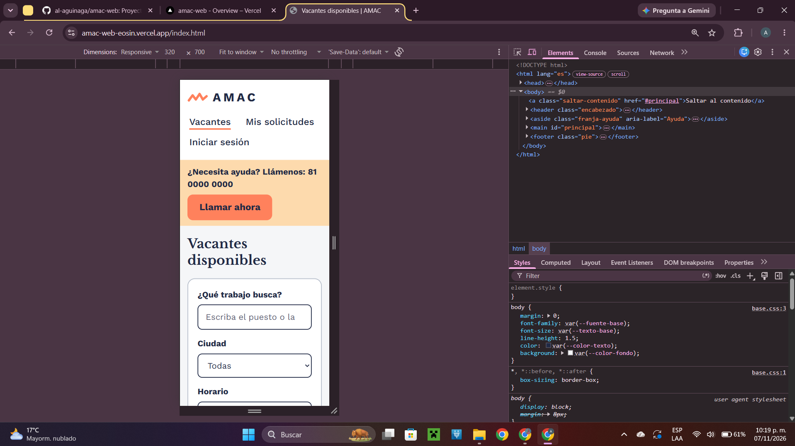
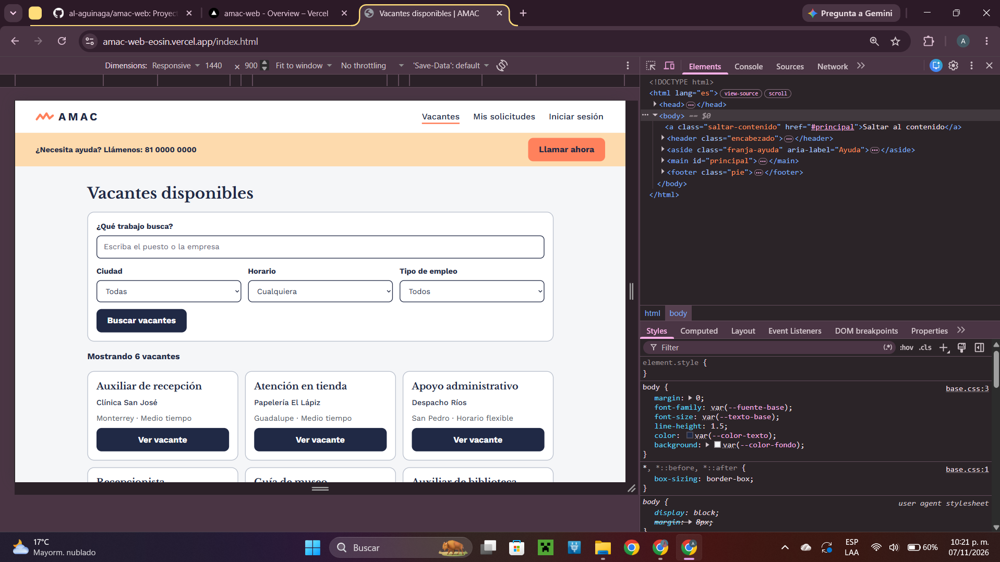
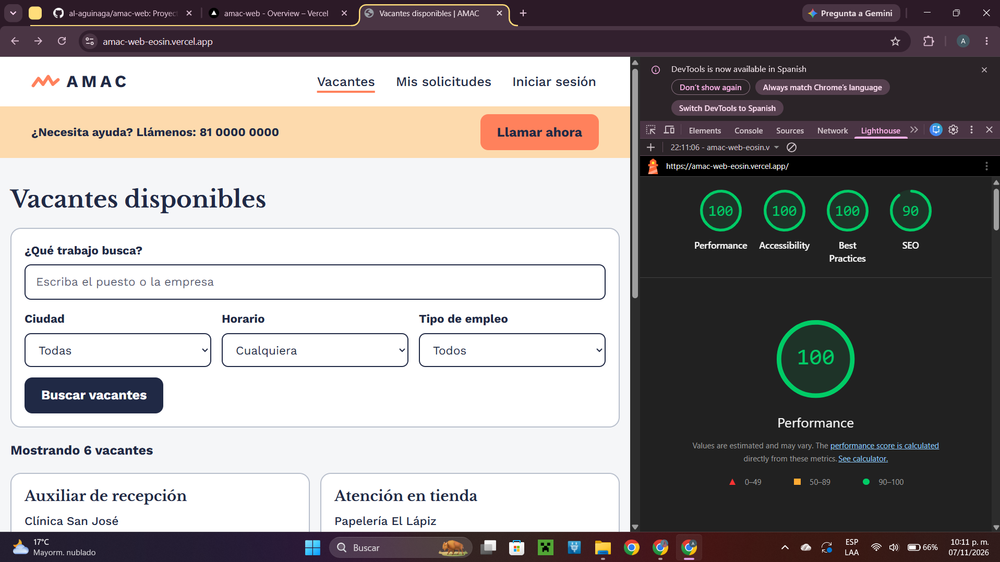

# AMAC

**Sitio publicado en Vercel:** https://amac-web-eosin.vercel.app
**Prototipo de Figma (Entrega 1):** https://www.figma.com/design/qoXt2EuZUhMGNxdyHFwg1U

# Integrantes y qué hizo cada uno

Integrante | Archivos | Qué hizo

Ryan Higgins | `css/variables.css`, `css/base.css`, `css/layout.css`, `index.html`, `img/` | Pasó los colores, tipografías y espaciados de Figma a variables CSS; hizo el reset, el foco visible y el enlace "Saltar al contenido", hizo el encabezado, la franja de ayuda, el pie, los contenedores y el grid responsivo, realizó el listado de vacantes con buscador, filtros y 6 tarjetas. 

Sofia De los Santos | `css/componentes.css`, `vacante.html`, `confirmacion.html` | Creó los componentes reutilizables (botones, tarjetas, paneles, filas, campos de formulario, etiquetas de estatus); hizo el detalle de vacante con "Postularme" y "Llamar", y la pantalla de confirmación. 

David Jiménez | `login.html`, `registro-candidato.html`, `mis-solicitudes.html` | Creó el inicio de sesión, el registro de candidato (con `fieldset`, `legend`, radios y casilla de términos) y Mis solicitudes con 3 estatus y el botón "Cancelar". 

Alejandro Aguiñaga | `empresa-vacantes.html`, `registro-empresa.html`, `solicitudes-recibidas.html`, `README.md`, `vercel.json` | Hizo el panel de vacantes de la empresa, el registro de empresa y las solicitudes recibidas; redactó este README y reunió las capturas de las pruebas. Por ultimo, agregó un .json para que la pagina de vercel tenga inicio en el inicio de sesión y no en la lista de vacantes.

# Estructura

```
amac-web/
|-- index.html _ vacante.html _ confirmacion.html _ login.html
|-- registro-candidato.html _ mis-solicitudes.html
|-- empresa-vacantes.html _ registro-empresa.html _ solicitudes-recibidas.html
|-- css/  variables.css _ base.css _ layout.css _ componentes.css
|-- README.md
|__ vercel.json

```

Flujo principal: `login.html` → `index.html` → `vacante.html` → `confirmacion.html` → `mis-solicitudes.html`.
Páginas opcionales: registro de empresa y solicitudes recibidas.

# Paleta y tipografías

Variable | Valor | Uso 

- `--color-primario` / `--color-texto` | `#202945` | Texto, botones principales, bordes de campos 
- `--color-acento` | `#FF815C` | Botón de la acción principal (texto azul marino) 
- `--color-cielo` | `#CAE4EF` | Estatus positivos, fondo de íconos 
- `--color-durazno` | `#FDDAAD` | Franja de ayuda, estatus "en revisión" 
- `--color-texto-suave` | `#4A5060` | Texto de apoyo (contraste alto) 
- `--color-fondo` / `--color-superficie` | `#F5F6F8` / `#FFFFFF` | Fondo de página / tarjetas 
- `--color-borde` / `--color-gris-claro` | `#B8BFCC` / `#E3E6EB` | Bordes y estatus cerrados 

Tipografías: **Libre Baskerville Bold** para títulos y **Work Sans** (400, 500, 700) para el contenido, según el manual de marca. Texto base `1.125rem` (18 px), títulos de `1.75rem` a `2.25rem`, botones de 52 px de alto.

# Componentes reutilizables (para la Entrega 3)

Clase | Componente de React 

- `.encabezado` + `.nav__lista` | `<Encabezado />` 
- `.franja-ayuda` | `<FranjaAyuda />` 
- `.pie` | `<Pie />` 
- `.boton` (`--primario`, `--acento`, `--secundario`)  `<Boton />` 
- `.tarjeta-vacante` | `<TarjetaVacante />` 
- `.fila` | `<FilaSolicitud />` 
- `.panel` | `<Panel />` 
- `.campo-formulario` | `<CampoFormulario />` 
- `.grupo` (`fieldset`) | `<GrupoCampos />` 
- `.etiqueta-estatus` | `<EtiquetaEstatus />` 

# Cambios respecto al Figma

- En celular, el menú de navegación se muestra como enlaces visibles abajo del logo en lugar del botón "Menú", porque esta entrega no usa JavaScript.
- El listado tiene 6 tarjetas (en Figma habían 3) por lo que pedia la entrega.
- "Llamar a la empresa" aparece solo en el detalle de la vacante (RF-051).
- Ni el logo ni el el teléfono son reales, por lo que es se ponen el logo oficial y el número real.
- Los botones de formularios y filtros son solo visuales. Los enlaces entre páginas sí funcionan.

# Accesibilidad

Texto base en `rem`, texto azul marino sobre el naranja por contraste, botones y enlaces de al menos 44 px, `label` visible en cada campo, `:focus-visible` con contorno de 3 px, `lang="es"`, un solo `h1` por página, enlace "Saltar al contenido" y estatus escritos con texto.

# Verificación
Capturas de pantalla de index.html en celular (320px) y en computadora (1440px). Y Captura del puntaje de Lighthouse




